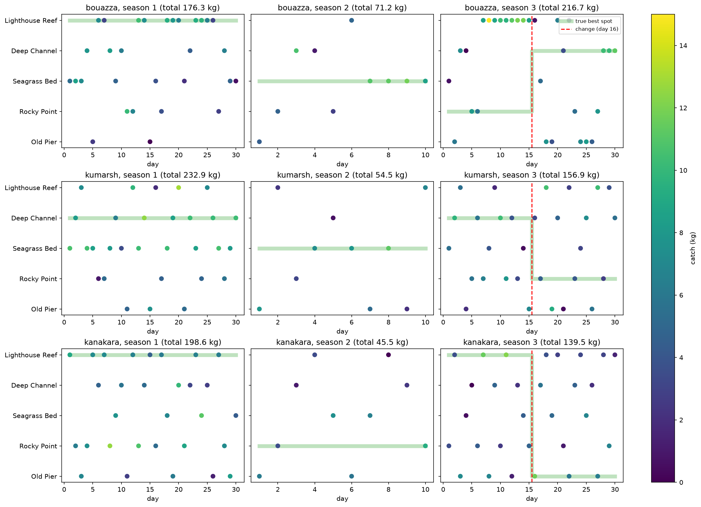
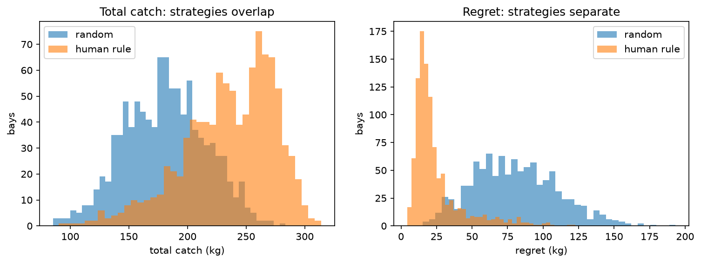
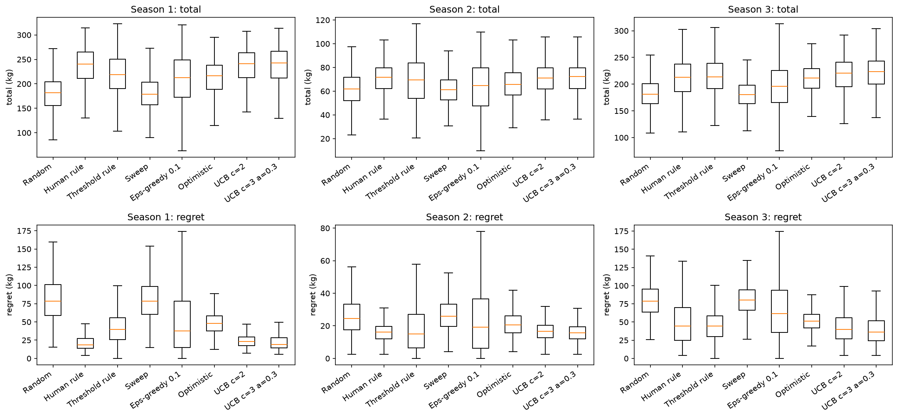
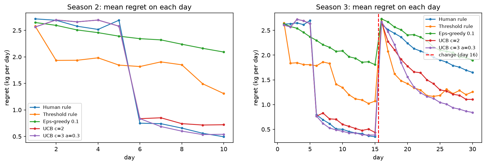
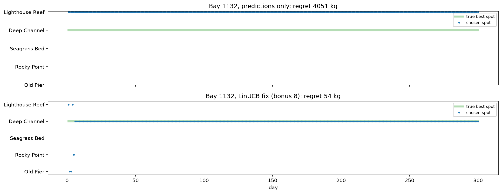

# MALIS Project 1: Fishing Season and Multi-Armed Bandits

Team: Soulaimen (log `bouazza`), Shubham Kumar (log `kumarsh`) and Adhitya (log `kanakara`).

> [!IMPORTANT]
> Draft written with an AI assistant from the results of `experiment.ipynb`. The team must check every statement, complete the Contributions section, and confirm the AI section before exporting to PDF. Remove this callout in the final version.

All numbers come from `experiment.ipynb`. Regret (defined in Section 2) is in kg. In Tasks 2 to 5, rules and parameters were chosen on bays with seeds 0 to 999 ("tuning bays"). Agents are compared on seeds 1000 to 1999 ("test bays").

## 1. Human play (Task 2)

| Member   | Season | Total | Best possible | Regret | Days at best | Switches |
| -------- | ------ | ----- | ------------- | ------ | ------------ | -------- |
| bouazza  | 1      | 176.3 | 213.0         | 38.7   | 11 / 30      | 18       |
| bouazza  | 2      | 71.2  | 99.0          | 28.6   | 4 / 10       | 5        |
| bouazza  | 3      | 216.7 | 279.0         | 69.0   | 6 / 30       | 13       |
| kumarsh  | 1      | 232.9 | 297.0         | 48.4   | 7 / 30       | 27       |
| kumarsh  | 2      | 54.5  | 77.0          | 30.9   | 3 / 10       | 9        |
| kumarsh  | 3      | 156.9 | 226.5         | 60.6   | 7 / 30       | 29       |
| kanakara | 1      | 198.6 | 288.0         | 66.0   | 8 / 30       | 29       |
| kanakara | 2      | 45.5  | 64.0          | 14.8   | 4 / 10       | 9        |
| kanakara | 3      | 139.5 | 259.5         | 121.0  | 6 / 30       | 29       |

**Soulaimen**'s notes describe a threshold strategy. In Season 1 he started at Seagrass Bed and sometimes tested a poor spot, but kept no fixed threshold: he stayed after a catch of 4.7 kg and left after one of 8.3 kg. In Season 2 he tried four spots, then stayed at the best from day 7. In Season 3 he never stayed after a catch below 6 kg, settled on Lighthouse Reef (9.6 kg, almost the best, 9.7 kg), and reacted to the change (Section 2).

**Shubham** wrote that he stayed at the spot that first gave most (Season 1), and that he tried each spot once, then repeated the best (Season 2). His logs differ: he changed spot on 27 of 29 days in Season 1, and in Season 2 did not stay at the best after trying all five. In Season 3 he chose at random, as his note says.

**Adhitya** wrote "randomly" (Season 1), "in a ordered way" (Season 2), and no method (Season 3). He changed spot every day, whatever the catch. In Season 2 he visited every spot once on days 1 to 5 and again on days 6 to 10.

We wrote the strategies as precise rules, all in `agents.py`:

- **Threshold rule** (`ThresholdRuleAgent`), from Soulaimen's notes. Start at Seagrass Bed. Stay while the catch is at least 6 kg. When leaving, test the spot unvisited longest if that is 8 days or more, otherwise go to the best-average other spot (a random new spot if none was visited yet). Ties are random.
- **Explore then commit** (`ExploreThenCommitAgent`), from Shubham's notes. Fish once at each spot, then always at the spot with the best average.
- **Sweep** (`SweepAgent`), from Adhitya's Season 2 note. Each day, a random spot not yet visited in the current sweep of all five.
- **Random** (`RandomAgent`), for the notes that say random.

To check that the rules apply to any log, we fed each rule a member's history and counted how often it picked the member's next spot. The threshold rule agrees with Soulaimen on 45% to 66% of days, and the sweep with Adhitya on 30% to 49% (random choice: 15% to 21%). For Shubham, the threshold rule and explore then commit are at the random level in Season 1: his note does not describe his play.

On the tuning bays, explore then commit has the lowest regret summed over the three seasons (89.8 against 106.6 for the threshold rule). It wins Seasons 1 and 2 (23.9 and 16.5, against 41.7 and 19.4): with a noise of 2.5 kg, even a 9.9 kg spot falls below 6 kg on 5.7% of days. Leaving quickly only helps in Season 3 (45.5 against 49.3), when spots get worse. The sweep is no better than random (79.4 against 79.9, Season 1). So the best human strategy, `HumanRuleAgent`, is explore then commit.

## 2. Separating decisions from luck (Task 3)

A season's total depends on three things: the bay (how good its best spot is), the noise of each catch, and the decisions. Our measure removes the first two. **Regret** is the sum, over the days, of the true average of the best spot that day minus the true average of the chosen spot. True averages remove the noise. Comparing with the best spot of the same bay removes the bay quality.

| Season 1, 1000 test bays | Random      | Human rule  |
| ------------------------ | ----------- | ----------- |
| Mean total               | 180.9       | 235.6       |
| sd of total              | 34.8        | 38.8        |
| sd from bay quality      | 33.6        | 33.6        |
| sd from noise            | 13.3        | 13.7        |
| Mean regret (sd)         | 80.2 (29.6) | 24.4 (17.9) |

The spread of the total is almost all luck. The human rule's total has a correlation of 0.81 with the bay quality, its regret only 0.13. Across different bays, as in our team, the random agent catches more than the human rule in 14.8% of pairs, but has a lower regret in only 4.9%. The total often ranks a random player above a good one, and regret rarely does.

**Season 2.** Soulaimen and Shubham lost about twice as much per day as in Season 1 (2.86 against 1.29 kg, and 3.09 against 1.61). With 10 days, finding the best spot takes a large part of the season. Adhitya lost less than in Season 1 (1.48 against 2.20): on that bay even random play has a regret of only 14.8.

**Season 3.** On day 16 every spot gets a new average. In Soulaimen's bay the best spot moved from Rocky Point (9.7 kg) to Deep Channel (8.9 kg), and his spot dropped to 2.3 kg. He adapted: he left it the next day and found Deep Channel 5 days after the change, but settled there only for the last 3 days. In Shubham's bay the best moved from Deep Channel to Rocky Point, and in Adhitya's from Lighthouse Reef to Old Pier. Both changed spot every day, and neither adapted: each spent 3 of the last 15 days at the new best spot, no more than chance.

## 3. Agents (Task 4)

| Agent                            | Memory                                             | Choice                                                                          | Parameters                              |
| -------------------------------- | -------------------------------------------------- | ------------------------------------------------------------------------------- | --------------------------------------- |
| `HumanRuleAgent`                 | Sum and count per spot                             | Each spot once, then best average                                               | None                                    |
| `ThresholdRuleAgent`             | Sums, counts, last visit, current spot, last catch | The rules above                                                                 | Start spot, threshold 6 kg, 8 days      |
| `EpsilonGreedyAgent`             | Estimate Q and count N per spot                    | Random spot with probability epsilon, else highest Q                            | epsilon, step size alpha, initial value |
| `UCBAgent`                       | Q, N, day t                                        | Each spot once, then highest Q + c sqrt(ln t / N)                               | c, step size alpha                      |
| `LinearRegressionAgent` (Task 6) | Per spot: A = ridge I + sum z z^T, b = sum z catch | Highest prediction + bonus sqrt(z^T A^-1 z), or random with probability epsilon | epsilon, bonus, ridge                   |

`EpsilonGreedyAgent` covers Sections 2.2 to 2.6 of Sutton and Barto: sample averages or a constant step size alpha (for a changing world), and optimistic initial values. `UCBAgent` is Section 2.7. With a constant alpha, both weight recent catches more.

## 4. Results (Task 5)

| Mean regret, test bays        | Season 1 | Season 2 | Season 3 |
| ----------------------------- | -------- | -------- | -------- |
| Random                        | 80.2     | 25.9     | 79.8     |
| Human rule                    | 24.4     | 16.4     | 49.4     |
| Threshold rule                | 41.7     | 18.6     | 45.4     |
| Sweep                         | 80.5     | 26.4     | 80.4     |
| Epsilon-greedy (0.1)          | 51.6     | 23.8     | 67.0     |
| Optimistic (Q0 15, alpha 0.3) | 48.9     | 21.2     | 51.6     |
| UCB (c 2)                     | 25.1     | 17.1     | 43.5     |
| UCB (c 3, alpha 0.3)          | 24.1     | 16.4     | 39.4     |

**Random bays.** In Season 1 the human rule and both UCB agents are close. UCB with c 2 has the shorter tail (95th percentile 46.6 against 66.6 for the human rule), because explore then commit decides after one catch per spot. Epsilon-greedy starts all estimates at 0 and keeps the first spot that gives anything, so it is either very good or very bad.

**Team bays.** On 8 of the 9 team bays, most learning agents have a lower regret than the member. The exception is Soulaimen's Season 3, where only UCB (c 3, alpha 0.3) matches him (67.7 against 69.0). The threshold rule looks good on the Season 2 bays (regret 0.0, 12.5 and 10.6), only because it starts at Seagrass Bed, which happened to be best, or tied best, in all three. A few bays cannot judge a strategy.

**Best agents.** For Season 2, the best agents are UCB (c 3, alpha 0.3) and the human rule, tied (16.4, paired difference 0.0 with standard error 0.2). In 10 days, one catch per spot and then commitment is about the best possible. For Season 3, UCB (c 3, alpha 0.3) is best (39.4), ahead of UCB with c 2 by 4.1 (se 0.5) and of the human rule by 10.0 (se 0.8). After the change, it forgets old catches and its bonus re-tests spots, so it recovers fastest. In a 200-day season with the change on day 101, its regret per day is 0.53 against 0.83 for UCB with sample averages.

**Parameter study.** We varied UCB's exploration strength c from 0 to 8 on the tuning bays.

| c        | 0    | 0.5  | 1    | 2    | 3    | 5    | 8    |
| -------- | ---- | ---- | ---- | ---- | ---- | ---- | ---- |
| Season 1 | 23.3 | 22.9 | 23.2 | 25.1 | 28.3 | 37.0 | 48.5 |
| Season 2 | 16.7 | 16.7 | 16.8 | 17.2 | 17.6 | 18.8 | 20.7 |
| Season 3 | 47.3 | 46.2 | 44.7 | 43.3 | 42.8 | 45.4 | 53.4 |

With c = 0, UCB tries each spot once and then exploits, like the human rule. In the stationary seasons, any c up to 1 works, and more exploration only wastes days at spots known to be poor. In Season 3 the best value is c = 3, because re-testing is what finds the new best spot.

## 5. Contextual bandits (Task 6)

`LinearRegressionAgent` predicts each spot's catch from wind, waves and tide with one ridge regression per spot, fitted on its own observations.

| Agent (200 test bays of 300 days)                    | Mean regret | Bays with 90%+ days at one spot |
| ---------------------------------------------------- | ----------- | ------------------------------- |
| Random                                               | 1319.8      | 0%                              |
| Best Part III agent, no context (UCB c 3, alpha 0.3) | 239.5       | 38%                             |
| Linear, predictions only                             | 1098.8      | 90%                             |
| Linear, epsilon 0.1                                  | 344.7       | 16%                             |
| Linear, bonus 8 (LinUCB)                             | 105.2       | 24%                             |

**Acting only on predictions fails.** An untried spot predicts 0 kg, so the first spot that gives a catch usually keeps the highest prediction, and the agent rarely collects the data that would correct it. On bay 1132 it fished at Lighthouse Reef on 100% of days, while Deep Channel was best on every day (regret 4050.6).

**Fix.** Epsilon-greedy avoids most lock-ins, but its random days cost more than the context gains: it is worse than ignoring the conditions. A linear fit to true averages loses only 0.2 kg over 300 days, so the problem is exploration, not the model. Our fix adds a confidence bonus to each prediction (LinUCB, the contextual form of UCB; Li et al., 2010). It explores only where uncertain, and its bonus (8) was chosen on separate tuning bays. It beats the Part III agent by 134.2 (paired se 10.9) and recovers bay 1132 (regret 53.8).

## Use of AI assistants

We used Claude Code (Anthropic), an AI coding assistant, for:

- a step-by-step guide to the project;
- writing the agents in `agents.py` from our strategy descriptions, and the analysis code in `experiment.ipynb`;
- running the experiments and drafting this report from the results.

We checked its work by running the notebook from top to bottom, comparing the agents' behaviour with our own rules, and reading every result in this report against the notebook output.

> [!IMPORTANT]
> The team must confirm or correct this section so it states exactly what was done and how it was checked.

## Contributions

> [!IMPORTANT]
> To be completed by the team: who did what.

| Member                  | Contribution    |
| ----------------------- | --------------- |
| Soulaimen (bouazza)     | To be completed |
| Shubham Kumar (kumarsh) | To be completed |
| Adhitya (kanakara)      | To be completed |
